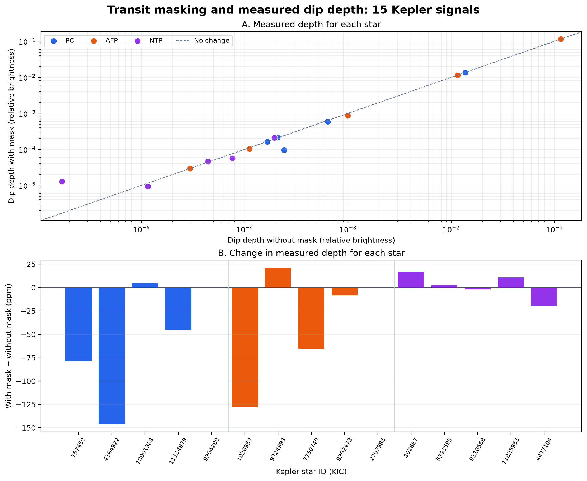
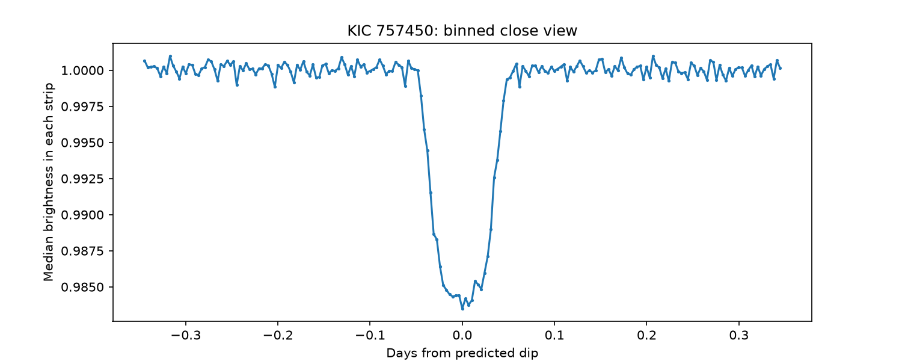
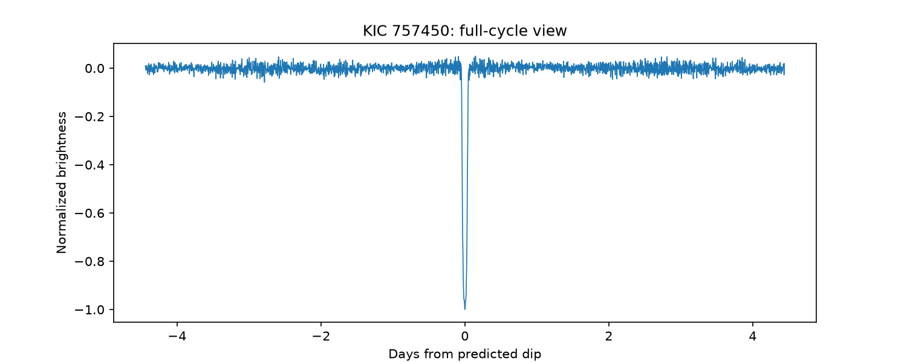
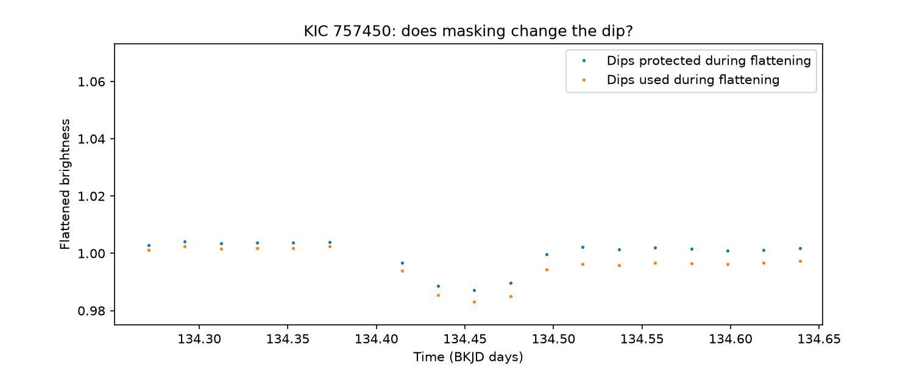

# Kepler light-curve preprocessing audit

**Question:** Does masking predicted transits while flattening a Kepler light curve change the depth we measure after folding it?

This is an exploratory comparison using 15 signals from the Kepler Q1–Q17 DR24 threshold-crossing event (TCE) catalog. It measures the effect of one processing choice; it does not classify new planets.



## From a toy dip to a measured Kepler signal

The project began with a made-up repeating dip, then followed one real star through the operations used in the analysis. `01_toy_lightcurve.py` creates the toy plot; `03_lightcurve2.py` is the exploratory walkthrough that creates the KIC 757450 plots. The figures show the steps in order:

| Step | Figure | What to look for |
| :--- | :--- | :--- |
| 1. Repeating toy dip | [Toy light curve](toy_lightcurve.png) | Three dips spaced four days apart. |
| 2. Original star measurements | [Early Kepler light curve](kic_757450_early_lightcurve.png) | Slow brightness changes obscure short dips. |
| 3. Catalog timing | [Predicted dip times](KIC_757450_predicted_dips.png) | Red lines land near repeated short dips. |
| 4. Remove the slow trend | [Flattened light curve](kic_757450_flattened.png) | Short dips remain after broad changes are reduced. |
| 5. Line up repeated dips | [Folded full cycle](KIC_757450_folded.png) | Repeated measurements gather at phase zero. |
| 6. Examine the dip | [Folded close view](KIC_757450_folded_close.png) | The short dip shape is easier to see. |
| 7. Summarize the close view | [201-bin local view](KIC_757450_binned_close.png) | One median brightness value per narrow phase bin. |
| 8. Inspect the whole cycle | [2,001-bin global view](KIC_757450_global_view.png) | Look for structure away from the central dip. |
| 9. Compare preprocessing | [One-dip masking comparison](mask_comparison_757450.png) | The two flattened curves have different nearby levels. |

### The binned and masked views

These plots show what was measured before the 15-star comparison. The **close view** collects the median brightness in 201 small phase bins around the predicted dip. The **global view** uses 2,001 bins across the whole predicted cycle; its median is shifted to zero and its lowest bin scaled to −1 to show shape. The close and global plots have different vertical scales, so their heights should not be compared directly.





The next plot compares masked and unmasked flattening around one predicted dip. Both versions can move vertically because each estimates the brightness trend differently. That is why the numerical analysis measures each dip **relative to its own nearby brightness**.



## Data and sample

- TCE metadata and training labels: [NASA Exoplanet Archive, Kepler TCE data](https://exoplanetarchive.ipac.caltech.edu/docs/Kepler_TCE_docs.html). The `av_training_set` labels are **PC** (planet candidate), **AFP** (astrophysical false positive), and **NTP** (non-transiting phenomenon). A PC label does not establish that a planet is confirmed.
- Brightness measurements: Kepler long-cadence light-curve FITS files from the [public Kepler archive](https://archive.stsci.edu/kepler/publiclightcurves.html), retrieved through STScI's public AWS mirror. Files are cached locally and are not committed to this repository.
- Sample: five training stars from each label, one TCE per star. Three stars examined during development were retained; four more per label were drawn with `random_state=42`. Signals were restricted to periods of at most 50 days and to those with enough phase space for the nearby comparison region (`4 × duration_in_days < period`). This is a small, partly chosen sample, not a representative survey of all TCEs.

The exact rows are in `selected_stars.csv`. The full numeric output, including measurement counts, is in `mask_results.csv`.

## Method

For each signal, the script joins the available long-cadence quarters and removes missing values. It makes two versions of the **same** light curve with Lightkurve's `flatten(window_length=401)`:

1. **Masked:** predicted transit measurements are excluded while estimating the broad brightness trend; the transit measurements remain in the output curve. The mask has a width of twice the catalog transit duration.
2. **Unmasked:** the trend is estimated using all measurements, including those near predicted transits.

Both versions use the same predicted period $P$, transit time $t_0$, and duration $D$. The folded position of each measurement is

$$\phi = ((t-t_0+P/2)\bmod P)-P/2.$$

Here $t$, $t_0$, $P$, $D$, and $\phi$ are all in **days**; the catalog duration is divided by 24 because it starts in hours. The measured depth is

$$\text{depth}=\operatorname{median}(F\text{ at }D\leq|\phi|\leq2D)-\operatorname{median}(F\text{ at }|\phi|\leq D/2).$$

This subtracts the typical brightness inside the dip from the nearby brightness, after repeated predicted dips have been aligned. The comparison uses the same phase regions for both flattened curves. The `401` window length counts brightness measurements, not days.

## Results from this pilot

All 15 selected stars yielded finite measurements. Masking gave a larger measured depth for **6** stars and a smaller depth for **9**. The median absolute difference between the two estimates was **17.2 ppm** of relative brightness (one ppm is one millionth). This is a *processing difference*, not a measurement uncertainty or a classification score.

Two useful cases illustrate the range of outcomes:

| KIC | Catalog label | Masked depth | Unmasked depth | Observation |
| ---: | :--- | ---: | ---: | :--- |
| 4164922 | PC | 0.00009494 | 0.00024091 | The depth estimate depends strongly on this processing choice. |
| 7750740 | AFP | 0.11478550 | 0.11485088 | The two estimates are very close relative to this deep signal. |

Figure A compares the two estimates on logarithmic axes; the dashed line means they agree. Figure B shows `masked − unmasked` in ppm for each star; bars above zero mean masking produced a larger measured depth.

**Interpretation:** The effect differs between individual signals and can be substantial relative to a shallow measured dip. Five stars per catalog category are insufficient to infer class-level behavior. The analysis does not establish which flattening choice gives the physically correct depth, measure statistical significance, or identify the astrophysical cause of any individual signal.

## Reproduce

Run these commands from the project directory in Command Prompt, with Python and the dependencies available:

```text
py -m pip install numpy pandas requests lightkurve matplotlib scikit-learn
py 02_catalog.py
py 07_batch_compare.py
py 08_plot_results.py
py 01_toy_lightcurve.py
py 03_lightcurve2.py
```

`02_catalog.py` reads `q1_q17_dr24_tce.csv` and creates `labeled_catalog.csv`. `07_batch_compare.py` also needs `view_tools.py` in the same directory. It saves `selected_stars.csv` and writes `mask_results.csv` when all selected stars finish successfully. An incomplete attempt is kept as `mask_results.csv.part` so a transient archive failure does not replace a complete result. After an archive listing has been saved for a star, re-running the script reuses its cached FITS files without another listing request. `08_plot_results.py` reads the result CSV and saves `mask_comparison_summary.png`. Running `03_lightcurve2.py` requires KIC 757450's FITS files to have been cached by the batch script; close each displayed plot window to let the walkthrough continue.

The repository contains the two learning scripts plus the catalog, light-curve utility, batch, and plotting scripts; the two catalog CSVs, selected rows, numeric results, and the generated figures. The local FITS cache is kept outside the repository.

## Limits and next questions

The sample was partly selected during development, the catalog labels are imperfect, and a single fixed flattening window may behave differently for stars with different periods or variability. Depths are pooled over phase; individual transits have not been given independent uncertainty estimates. A larger prespecified sample and per-transit uncertainty analysis would be needed for population claims. A star-separated classifier or CNN would be a separate follow-up project, with its own baseline and held-out evaluation.

Development note: The batch and plotting scripts were drafted with AI assistance during an interactive, step-by-step exploration. The catalog choices, measurements, and limitations are recorded so they can be inspected and reproduced.
